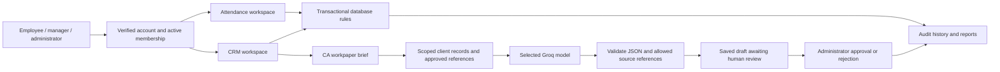

# PSB Workspace: review, verdict and CA AI delivery

13 October 2026. Assessment of the current repository, not a certification of enterprise readiness.

## Verdict and ratings

**Technology stack: 8.5/10 for this product.** Retain Next.js, TypeScript, React, Supabase Auth/PostgreSQL/Storage and Vercel. The stack supports the firm's current portal and transactional workflows well. Changing frameworks would not solve the principal gaps: business invariants, evidence quality, provider activation and operational verification.

**Product maturity before this review: 5.5/10 against the proposed MNC CA platform.** Substantial attendance and CRM workflows existed, but serious access-control and attendance integrity defects remained, and AI was limited to support-reply drafting. Passing frontend tests did not prove those database rules.

The delivered changes strengthen the foundation and add a supervised CA AI workbench. The [second quality pass](quality-upgrade.md) adds retained document versions, interrupted-upload recovery, scoped team attendance, derived history, written rejection reasons and dated reminders. Actual concurrent leave/month-close tests and authenticated HTTP/Storage acceptance now pass. This does not establish autonomous taxation/legal execution or MNC-scale capacity. Live provider evaluation, realistic load testing and restore drills remain required before any perfect-score claim.

| Area | Assessment | Decision |
| --- | --- | --- |
| UI and application | Typed server-rendered application, modular navigation, compact mobile UI | Keep; add recoverable errors and accessible drawer focus handling |
| Data and transactions | PostgreSQL is suitable for atomic approvals, balances and invoices | Keep; enforce invariants in the database and share month/employee locks |
| Authorization | RLS and scoped functions exist, but ACL and snapshot defects were verified | Fix default function privileges, onboarding enforcement and report scope |
| AI | Groq adapter exists; reply text was not a CA workflow | Add evidence-backed workpapers with persisted drafts and reviewer decisions |
| Operations | Local tests and benchmarks existed; CI was missing | Enforce lint, typing, tests, build and production dependency audit in CI |
| Enterprise scale | Prior warm-response and 10k-row measurements exist | Measure realistic concurrency, p95/p99, backup restore, availability and costs before capacity promises |

## Mental model

Attendance and CRM share identity and organizational scope. Attendance remains independently navigable. Specialist workpaper modes share one tested drafting interface instead of five independent model runtimes. The chosen mode changes the objective; the trusted database supplies access scope and facts. Model output never invokes filing, payment or messaging actions.

## Implemented in this delivery

### CA AI workbench: `/crm/ai-team`

Five workflows: tax preparation, compliance review, legal paperwork, document review and finance review. Every workpaper records its title, requirement, client (optional), jurisdiction and reporting period.

Workflow: **draft -> running -> needs review -> approved / rejected**. Failed generation is retained and can be retried. A run interrupted while running can be retried after a five-minute lease timeout. This is a bounded, user-triggered generation flow, not a background worker queue.

- Brief creation is idempotent; a changed payload cannot reuse the same request ID.
- Workpapers are private to their creator and administrators. Only the creator can generate a draft; administrators manage review and reference approval. Saved evidence is rechecked against current source access, so reassignment or reference retirement cannot leak records through an old workpaper.
- Retrieval uses authorized client records and approved, unexpired reference extracts for the exact jurisdiction. It reads document metadata, not binary file contents.
- Context is a bounded snapshot: up to 20 reference extracts and the latest 15 accessible records per selected module. Finance includes recorded invoice receipts. The reporting period is an explicit brief field, not a claim that every context record belongs to that period.
- Output contains summary, source-linked findings, missing information, next actions and review notes. Runtime validation rejects malformed structure, unsupported findings and references outside the supplied snapshot.
- The server persists model identity, evidence snapshot, attempt count, failure state and reviewer note. Audit records accompany lifecycle changes.
- Only a trusted server role can finalize model results; users cannot forge a completed result through a public database function.
- Workpapers can be downloaded as plain text, with status and evidence. Approval records human acceptance of the workpaper, not filing or payment completion.
- Workpapers and references can be saved without AI credentials. Actual generation requires `GROQ_API_KEY`, `GROQ_MODEL` and the existing server Supabase credential. No provider sends are made automatically.

### Verified security and attendance fixes

1. Revoke public/anonymous/authenticated execution of reconciliation and internal functions; retain trusted scheduler/server access. Reject future reconciliation dates.
2. Restrict complete firm report snapshots to admin/partner. Team-level access cannot expose whole-firm JSON snapshots.
3. Enforce active membership, active linked employee and completed password onboarding inside protected database helpers and legacy write paths. Preserve password-change and identity recovery access.
4. Serialize attendance, leave and correction operations using month locks and a common employee lock. Core helper functions cannot be called directly to bypass wrappers.
5. Reject corrections outside employment and future checkout times; revalidate approval. Allow rejection of stale corrections without accepting obsolete punch revisions.
6. Prevent punches/corrections conflicting with approved full-day leave. Recheck employment/calendar and attendance conflicts before leave approval.
7. Block month close on overlapping pending leave, corrections or incomplete attendance. Locked months require reopening before changes.
8. Serialize overlapping leave submission and provision a missing requested-year default balance without overwriting existing allocations. Require separate leave requests across calendar years until split-year deductions are implemented.
9. Scope monthly leave/blocker totals consistently and count leave within the selected month's working days.
10. Add correct organization-local month selection, visible close/reopen errors, reasoned reopening, immutable version selection and snapshot-based CSV exports.
11. Contain mobile drawer focus, restore it on close, make background content inert and clean up scroll locks on viewport changes.
12. Add a recoverable portal error screen, baseline browser security headers and automated application CI checks.

## Remaining product work for the full enterprise suite

| Workstream | Concrete next acceptance requirement |
| --- | --- |
| Provider activation | Configure Groq/Gmail/WhatsApp and SMTP, exercise supervised live connections, evaluate specialist answers against firm-approved cases |
| Legal/tax execution | Define jurisdiction-specific forms, rule sources, professional sign-off and authorized government/accounting connections; retain filing acknowledgements |
| Document intelligence | Versions, quotas and recoverable uploads now work; add extraction/OCR, malware checks and reviewed extracted facts before using file contents |
| Reliable channels | Verified inbound intake, sender matching, delivery callbacks, durable dispatch attempts, provider reconciliation and replay/pause controls |
| Compliance recurrence | Dated reminders now work; add versioned statutory catalogue, recurring obligations and escalation rules |
| Finance | Numbered invoice line items/tax fields, generated invoices, reversals and trusted bank reconciliation |
| Advanced attendance | Derived history, filtered scoped team register and concurrent month-close acceptance now work; add dated policy assignments, annual allocation UI, accrual and payroll |
| Enterprise administration | Agreed company/subsidiary model, SSO/MFA configuration, retention, restore drills, deployment monitoring and measured capacity/cost targets |

These are tracked implementation requirements, not working features disguised as settings. The competitor's announcement supplies categories but does not establish a verified feature specification or performance baseline.

## Verification approach

Application checks include lint, TypeScript, rendered interaction/domain/provider tests and production build. Database scripts use generated fixtures with transaction rollback and exercise actual privileges, RLS and business functions. The new future-correction test failed against the previous implementation and passed after the integrity migration. No real employee attendance or client messages are used as test fixtures.

Provider tests validate request construction and output contracts with mocked responses; they are not evidence of live model quality or delivery. CI now includes isolated fresh-database migration replay and database workflow checks. Full interactive browser acceptance, provider activation and statistically meaningful load/restore tests remain explicit release work.

## Industry references used

- [OWASP ASVS](https://owasp.org/projects/asvs): verification framework for authentication/access and application controls. No ASVS certification is claimed.
- [Supabase RLS guidance](https://supabase.com/docs/guides/database/postgres/row-level-security): database authorization and performance practices.
- [Groq structured output documentation](https://console.groq.com/docs/structured-outputs): strict schema support is model-dependent. Current adapter uses JSON mode plus application validation for the configured model.
- Bundled Next.js 16.4 documentation: server action authorization, route handlers, error recovery and header configuration.
